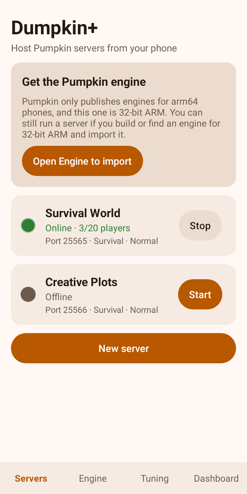
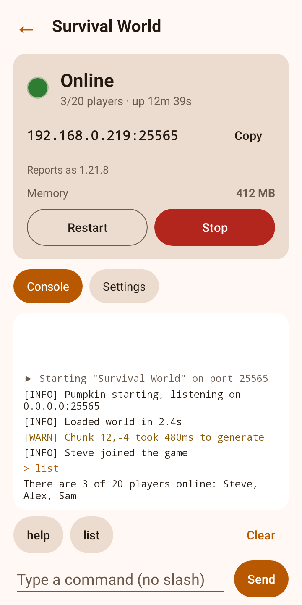
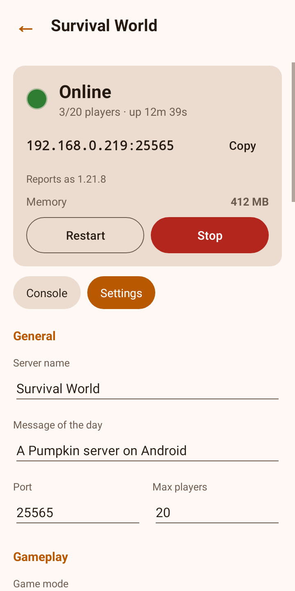

<p align="center">
  
</p>

<h1 align="center">Dumpkin+</h1>

<p align="center">
  Host <a href="https://pumpkinmc.org/">Pumpkin</a> Minecraft servers from an <strong>older Android phone or tablet</strong>,
  and manage them from any browser.<br>
  A port of <a href="https://github.com/colebolebole/Dumpkin">Dumpkin</a> for <strong>Android 5.0 and newer</strong>. Alpha.
</p>

<p align="center">
  
  &nbsp;
  
  &nbsp;
  
</p>

---

## What this is

Dumpkin needs Android 8.0 and a recent phone: it is built with Jetpack Compose and Material 3 Expressive, which are heavy
on memory and CPU and can't run on old Android versions. Dumpkin+ keeps everything Dumpkin does, and rebuilds the parts
that stood in the way of older devices:

| | Dumpkin | Dumpkin+ |
| --- | --- | --- |
| Minimum Android | 8.0 (API 26) | **5.0 (API 21)** |
| UI | Jetpack Compose, Material 3 Expressive | Plain platform views, no libraries |
| APK size (release) | Compose and Material 3 add several MB | **about 0.25 MB** |
| Runtime dependencies | AndroidX, Compose, Material 3, coroutines | coroutines only |
| Engine downloads | arm64 (Android 7+) | arm64 (Android 7+), **unofficial 32-bit ARM (Android 5+)**, and **import from a file** |
| Android package | `app.dumpkin` | `app.dumpkinplus` (installs next to Dumpkin) |

The server side is the same code as Dumpkin: the same `pumpkin.toml` editing, the same per-server settings, memory limit,
crash auto-restart, Bedrock port, the same web dashboard and JSON API. Servers and settings from one app are not shared with
the other.

## Features

- **Everything from Dumpkin:** multiple servers, live console, one-tap restart, per-server Bedrock port, memory limit, CPU
  threads, packet compression, the Device tuning tab, and the password-protected web dashboard (see [Web dashboard](#web-dashboard)).
- **Runs on Android 5.0+.** Every call to a newer API sits behind a version check, and the build fails lint on any that doesn't.
- **Light on old hardware.** No Compose, so the app starts fast and keeps its memory for the server. The console keeps 1000
  lines instead of 2000, the dashboard polls less often, and screen refreshes are slower and cheaper.
- **Defaults sized for the phone.** On a phone with about 2.5 GB of RAM or less, new servers start with a shorter view
  distance (the new **Low-end** quick pick: 4 / 3 chunks) and 8 players instead of 20.
- **Engine update checks.** The Engine tab checks for newer engine builds: Pumpkin's own channels and, on phones that use it, the
  [32-bit ARM releases](https://github.com/colebolebole/pumpkin-android-armv7/releases) (the newest few, pre-releases included).
  It flags a new version, a new nightly, or the same version rebuilt (a changed checksum), puts a dot on the Engine tab, and
  updates in one tap. It checks when the app starts, at most every 6 hours (switch it off on the Engine tab), or on demand
  with **Check for updates**. This is for engines only: Dumpkin+ doesn't update itself.
- **Import an engine from a file.** Very old Android versions often can't verify GitHub's certificates, and some CPUs
  have no download. Copy the engine to the phone and pick it in the Engine tab. It is checked against the phone's CPU
  before it is ever run, so a wrong-architecture file is refused with a clear message.
- **Android-5-aware Tuning tab.** No Doze before Android 6, so the battery check says so instead of nagging; old Snapdragon
  chips (MSM8916, MSM8994, ...) are named from `/proc/cpuinfo`; the Wi-Fi and notification checks use APIs that exist on 5.0.
- **Dark, light or automatic** (Auto follows the system on Android 10+, light below that).

## Before you install: read this

Whether your phone can host depends on its CPU and Android version, not just on this app.

- **arm64 phones on Android 7.0 or newer**: use the official Pumpkin download in the Engine tab.
- **Android 5.0 and 6.0 phones, and all 32-bit ARM phones**: the Engine tab offers the **unofficial 32-bit ARM build** from
  [colebolebole/pumpkin-android-armv7](https://github.com/colebolebole/pumpkin-android-armv7/releases). It is built against
  Android API 21 and works on 32-bit phones and on 64-bit ones that still run 32-bit apps (a Galaxy S6 does). The app checks
  the download against the SHA-256 GitHub reports and refuses a file that doesn't match.
  The official build can't be used here: it is linked for Android 7.0 and imports `getifaddrs()`, which only exists from
  Android 7.0, and it binds every symbol at load, so Android 5 and 6 refuse to load it.
- **x86 devices** and everything else: import only.
- The engine is about **90 MB** (32-bit) or **120 MB** (official arm64), and a Minecraft world adds to that. Check you have the space.
- Pumpkin needs a real amount of RAM. On phones with 1 to 2 GB expect one small server for a few friends at best.

**What has and hasn't been checked.** It builds, the unit tests pass, lint reports no use of an API newer than 21, and the real
screens were built and driven on emulated Android 5.0 and Android 14. It has **not** been run on a physical Android 5 phone.

I downloaded both engines and read their headers without running them. The official `pumpkin-aarch64-android` is a PIE arm64
binary built for API 24 that imports `getifaddrs` and `freeifaddrs` (both added to Android in 7.0). The community
`pumpkin-armv7-android` is a 32-bit ARM ELF whose SHA-256 matches the one in its release. Neither has been run on a real phone,
and the 32-bit build's own notes say it is not tested on a device yet. **Treat the 32-bit build as experimental.**

If a server won't launch, the console says why. Please open an issue with the phone model and the message.

## Install

1. Download `Dumpkin+-<version>.apk` from the Releases page (or [build it](#build)).
2. Allow installs from unknown sources, then open the APK on the phone.
3. Open the **Engine** tab and download the engine it offers for your phone (official arm64, or the unofficial 32-bit build). Use **Import from file** for anything else.
4. Open the **Tuning** tab and deal with anything it flags.
5. On the **Servers** tab, tap **New server**, then start it. Players on the same Wi-Fi join with the address on the server screen.

If the download fails with a certificate message, that is the old-Android problem above: download
`pumpkin-aarch64-android` from [Pumpkin's releases](https://github.com/Pumpkin-MC/Pumpkin/releases) on a computer, copy it to
the phone, and use **Import from file**.

## Web dashboard

Open the **Dashboard** tab and turn the switch on. Dumpkin+ starts a small web server on the phone (port `8080` by default).
Open the address it shows in a browser on another device on the same Wi-Fi, sign in with the password from the same tab, and
you can create, start, stop, restart and delete servers, watch the console, change every setting, edit `pumpkin.toml` and
manage engine downloads.

The dashboard's page needs a reasonably modern browser (it uses current JavaScript), which means the PC or newer phone you
manage things from, not the old device hosting. It works fully offline and nothing is loaded from the internet.

**Security.** Plain HTTP for your home network, protected by a password:

- A random password is generated (`XXXX-XXXX-XXXX`). Change it or make a new one from the Dashboard tab.
- After 5 wrong passwords an address is locked out for a minute, doubling each time up to 15 minutes.
- Sessions use random 256-bit tokens in `HttpOnly`, `SameSite=Strict` cookies and last a week, or until the app restarts.
- State-changing requests must carry a custom header and a matching `Origin`, and the `Host` header must be an address or
  local name, which blocks cross-site requests and DNS rebinding.
- **Don't forward the port to the internet.**

<details>
<summary>JSON API</summary>

Sign in with `POST /api/login` (`{"password": "..."}`), keep the `dk_session` cookie, and send `X-Requested-With: Dumpkin`
on every non-GET request.

| Method and path | What it does |
| --- | --- |
| `GET /api/state` | Phone info, engine builds and every server with its status |
| `POST /api/servers` | Create a server (`name` plus any setting) |
| `GET`, `PATCH`, `DELETE /api/servers/{id}` | Read, change or delete a server (delete only while stopped) |
| `POST /api/servers/{id}/start`, `/stop`, `/restart` | Start, stop or restart it |
| `POST /api/servers/{id}/command` | Send a console command (`{"command": "list"}`) |
| `GET /api/servers/{id}/logs?after=N` | Console lines after line `N` |
| `GET`, `PUT /api/servers/{id}/config`, `POST .../config/reset` | Read, write or reset `pumpkin.toml` |
| `GET /api/engine`, `POST /api/engine/refresh`, `/download`, `DELETE /api/engine/{id}` | Manage engine builds |

</details>

## Server settings

Open a server and switch to **Settings**. Changes to a running server apply after a restart (the **Restart** button on the
server screen), except the memory limit, which applies as soon as you save.

| Section | Setting | What it does |
| --- | --- | --- |
| General | Name, MOTD, port, max players | Port must be 1024-65535 and unique across your servers |
| Gameplay | Game mode, difficulty | Written to `default_gamemode` / `default_difficulty` |
| Performance | **Quick pick**: Low-end (4/3), Fast join (6/4), Balanced (8/6), Detailed (12/8) | Sets view and simulation distance together |
| | View distance (2-24), simulation distance (2-16) | Joining sends every chunk in view distance, so lower values join faster and use less RAM |
| Resources | **Limit memory**, **When exceeded**, **CPU threads**, **Restart after a crash** | See [How it works](#how-it-works) |
| Network | Packet compression, online mode, skins, lightweight ping, Bedrock support and port | As in Dumpkin |
| Engine | Build to use | "Newest", or pin an installed build |

## How it works

- **Memory limit.** Pumpkin is native code with no heap setting, so Dumpkin+ reads the server's resident memory
  (`VmRSS` in `/proc/<pid>/status`) every 2 seconds and acts if it stays over the limit twice in a row. It is a soft limit.
  Finding the process id uses a field that exists on every Android version from 5.0 up.
- **Stopping.** Sends `stop`, waits 15 seconds, then terminates the process. On Android 7 and older it ends with `SIGKILL`
  through `android.os.Process` instead of `Process.destroyForcibly()`, which only exists from Android 8.
- **Readiness and player count.** The standard Minecraft status ping against the local port, every 250 ms while starting,
  then every 10 seconds.
- **Wi-Fi lock.** The high-performance mode below Android 10 and the low-latency mode on 10 and newer.
- **Why `targetSdk = 28`.** The engine is downloaded at runtime and run from app storage, which Android 10+ forbids for apps
  targeting API 29+. Like Termux, Dumpkin+ is meant to be sideloaded rather than published on Play. If a device refuses a direct
  exec, the runtime retries through the system linker (`linker64` or `linker`).

## Build

Requires JDK 17+ and the Android SDK (platform 36). The Gradle wrapper is checked in. Create `local.properties` with
`sdk.dir=<path to your SDK>`, or set `ANDROID_HOME`.

```bash
./gradlew assembleDebug        # app/build/outputs/apk/debug/app-debug.apk
./gradlew assembleRelease      # minified; signed with the release key if configured (see below)
./gradlew testDebugUnitTest    # config patcher, validation, web server and API, login security, ELF checks, UI smoke tests
./gradlew lintDebug            # NewApi and InlinedApi are errors: anything newer than API 21 must be guarded
```

The UI smoke tests build and drive the real screens under Robolectric on **Android 5.0 (API 21) and Android 14 (API 34)**,
so both the legacy and modern code paths are covered without a phone. They use Robolectric 4.12.2 because newer versions
dropped API 21.

### Screenshots

The images in `docs/screenshots` are the real screens rendered under Robolectric with made-up servers (the phone is a
fake Android 14 device, so it reports as 32-bit ARM and shows the import notice). Regenerate them with:

```bash
DUMPKINPLUS_SCREENSHOTS=1 ./gradlew testDebugUnitTest --tests '*Screenshots*' --rerun
```

`tools/make-icons.ps1` redraws the launcher and notification PNGs that Android 5 to 7 need (Windows PowerShell only).

### Release signing

Release builds are signed with a private key that is **not** in this repository.

1. Create a keystore once, outside the repo:

   ```bash
   keytool -genkeypair -keystore ~/.dumpkinplus/dumpkinplus-release.jks -storetype PKCS12 -alias dumpkinplus \
     -keyalg RSA -keysize 4096 -validity 10950 -dname "CN=Dumpkin+"
   ```

2. Copy `keystore.properties.example` to `keystore.properties` (git-ignored) and fill it in, or set the
   `DUMPKINPLUS_KEYSTORE_FILE`, `DUMPKINPLUS_KEYSTORE_PASSWORD`, `DUMPKINPLUS_KEY_ALIAS` and `DUMPKINPLUS_KEY_PASSWORD`
   environment variables.
3. Build with `./gradlew assembleRelease -PrequireReleaseKey`, which fails if the key is missing instead of falling back to
   the debug key. Never publish a fallback build.

> [!IMPORTANT]
> **Back up the keystore and its passwords.** Android only installs an update signed with the same key, so if it is lost
> every user has to uninstall and reinstall, losing their servers.

## Notes

- Pumpkin is under heavy development and not every vanilla mechanic exists yet. **Keep backups of your worlds.**
- If a server won't start after changing settings, use **Reset configuration** (Settings, Advanced). Pumpkin resets the whole
  config if a value has the wrong type, so Dumpkin+ only writes documented keys with values inside the documented ranges.

<details>
<summary>Keys Dumpkin+ writes to <code>pumpkin.toml</code></summary>

- Top level: `default_gamemode`, `default_difficulty`, `use_favicon`
- `[networking.java]`: `address`, `online_mode`, `max_players`, `view_distance`, `simulation_distance`, `motd`
- `[networking.java.compression]`: `enabled`, `level`
- `[networking.java.authentication.textures]`: `enabled`
- `[networking.bedrock]`: `enabled`
- `[networking.bedrock.nethernet]`: `address` (`0.0.0.0:<bedrock port>`)
- `[commands]`: `use_tty = false`
- First run only, all set to `false`: `[telemetry]`, `[networking.query]` and `[networking.management]` `enabled`

</details>

## License

Dumpkin+ is released under the [MIT License](LICENSE), like the Dumpkin project it is derived from.

## Credits

Dumpkin+ is an unofficial project and is not affiliated with Pumpkin, Mojang or Microsoft. Pumpkin is licensed GPL-3.0;
Dumpkin+ does not include or link against it, it only downloads the released binary at runtime (or imports a file you give
it) and runs it as a separate process, so the MIT license covers Dumpkin+'s own code and Pumpkin stays under its own license.
